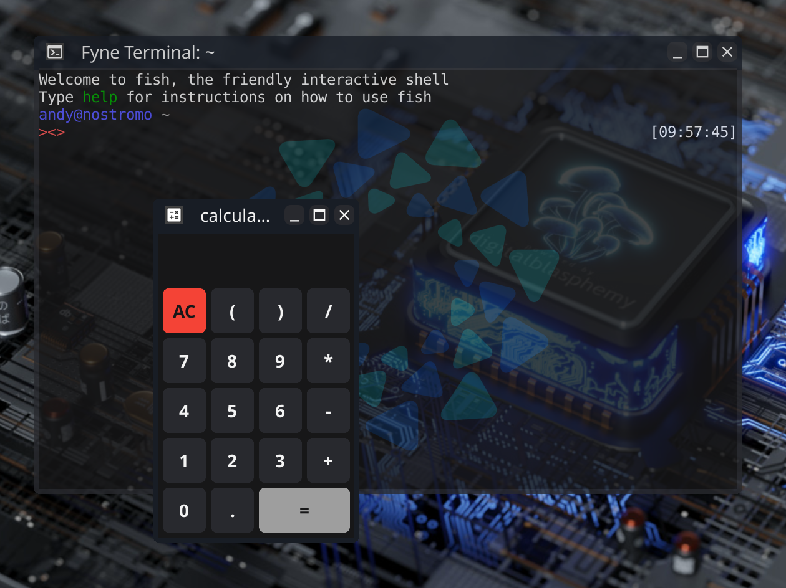
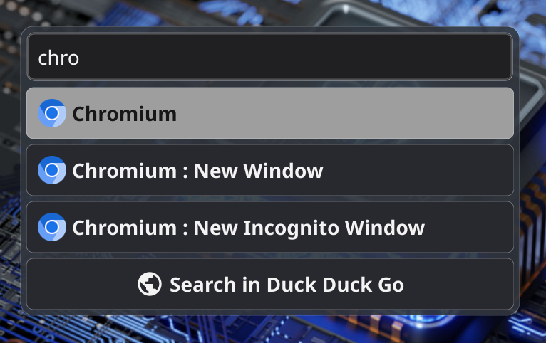
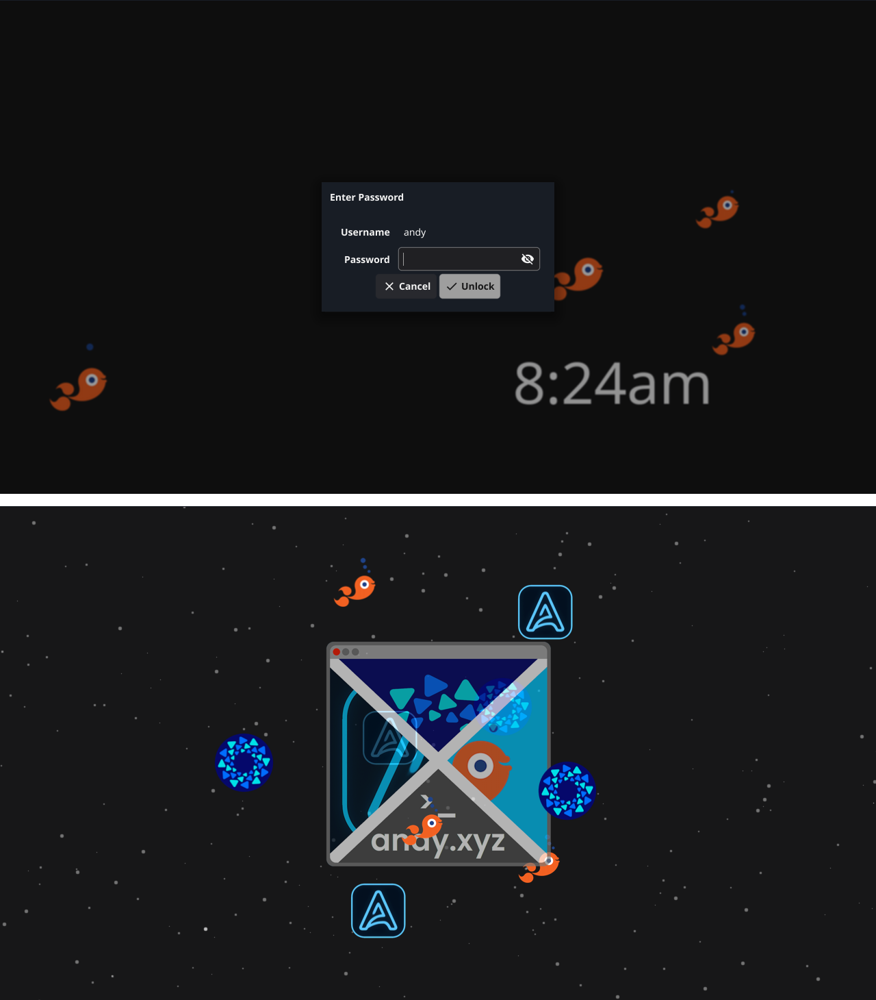
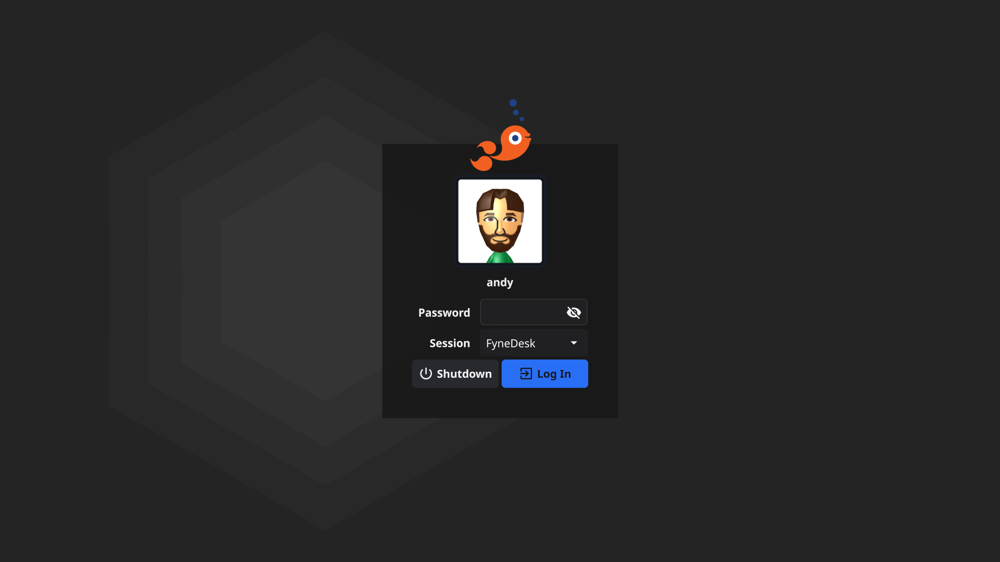
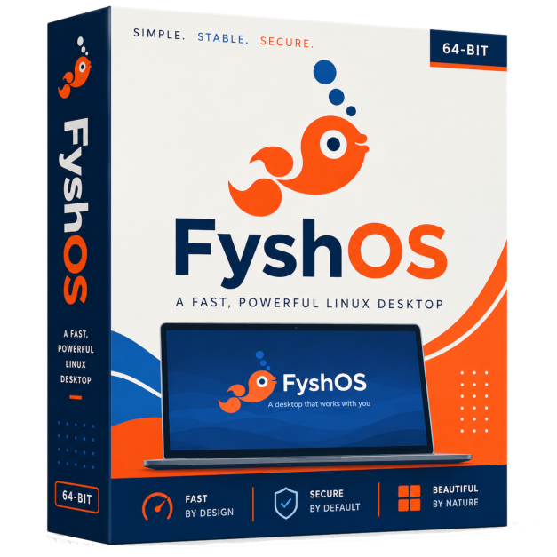
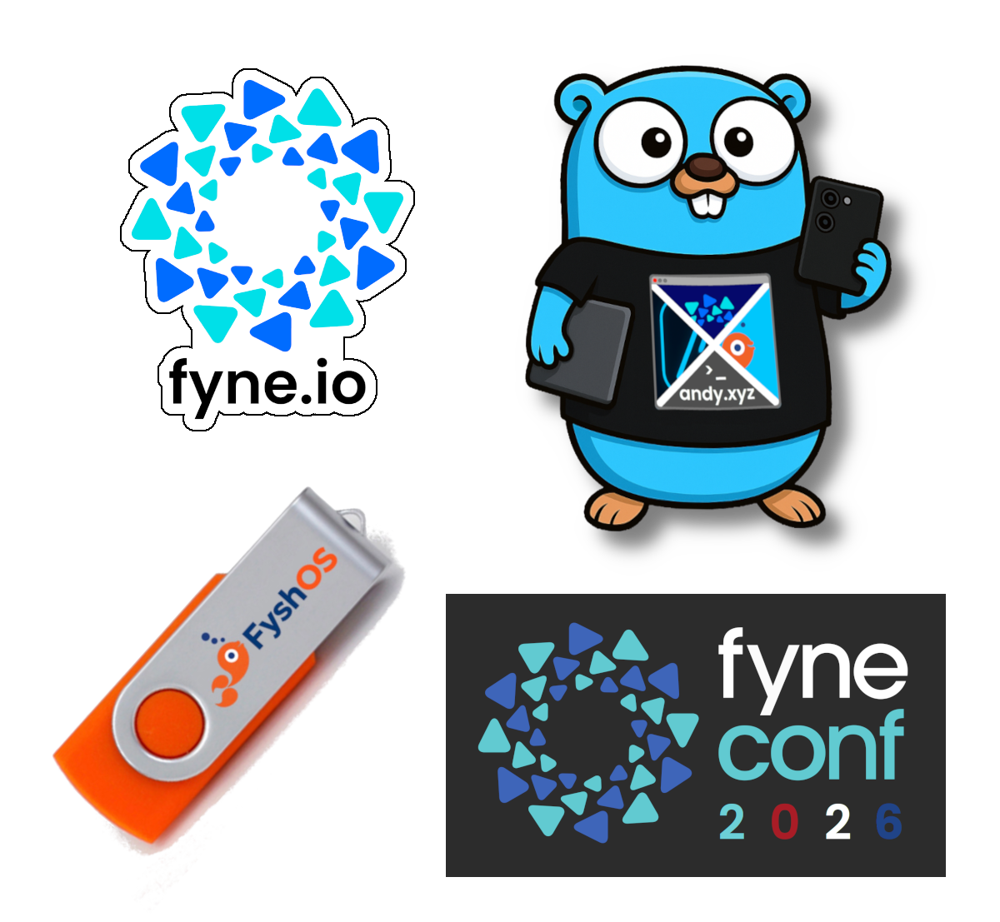

+++
theme = "gophercon"
name = "" #"Andy Williams"
footer = "" #"GopherCon 2026"
+++

<!-- Hello GopherCon! It is amazing to be back to the best Go community gathering! -->
# Building a Full Desktop in Go!
## (windows, desktops, compositing, ...AI?)

<!-- Today I want to talk to you about building an entire desktop with Go -->
---

<!-- Why? Because I'm a little bit crazy and I love big vision projects -->
# Another Desktop? Why?

*
* Linux on the Desktop!
  <!-- learned from Enlightenment -->
* Performance AND productivity
  <!-- Go is an amazing fit for this - who knew!? -->
* A developer oriented desktop
  <!-- great to use, easy to enhance -->
* The ultimate proof of **Fyne.io**

---

# Architecture

* Server (X11 / Wayland)
* Window Manager
* Compositor
* Virtual Desktops
* App icons and launcher
* Modules & overlays

---

# Window Manager

* Capture content / events
* Draw borders
* Stacking & position
* Iconify / Maximize
* Fullscreen / borderless

---

# Compositor

* Capture visible windows
* Draw:

  * Background
  * Underlays (files, widgets)
  * Windows
  * Panels & overlays

---

# Virtual Desktops

* Just a big virtual space
* Move the image, not window
* Desktop pager, flip & zoom
* Key bindings and menus
* *And sync actual X11 windows*

---

# App icons and launcher

* Manage installed apps
* Load metadata and icons
* Launch apps and:

  * Conversions, calculations
  * Search the web
  * AI suggestions/chat

---

# Modules

* Main extensibility point:

  * Status area (system tray, wifi etc)
  * Screen area (Fyles, backgrounds)
  * Launcher (Conversion, web search, AI)
  * Keyboard (brightness, airplane etc)
  * Overlays (flames, eSheep & more)

---

# ScreenSaver

* Just another Fyne app
* One window per screen
* Fullscreen - swallow all events
* Password and fingerprint support
* Drop-in custom visual

---

# Login Manager

*
* App that launches desktop
* Handle users & logins
* Selecting desktop
* Reflect user configuration

---

# AI Integration - local and frontier

* Local with Kronk or Ollama
* Connect OpenAI or Anthropic
* Fathom: Chat and quick answers
* Choose model and reasoning
* Control the desktop (in progress)

---

# All Together = FyshOS

  * tyde & fin
  * backgrounds / appie
  * dryvers / screens
  * fancyfs / fyles
  * fyshsaver
  * ferry

---

# Bonus: WYSIWYG App Editing

---

# Find out more

* https://fyshos.com
* github.com/FyshOS/tyde
* #fyne
* @andydotxyz
* https://andy.xyz
* https://apptrix.ai

