+++
theme = "gopherconuk"
name = "Andy Williams"
footer = "GopherCon UK 2026"
+++


<!-- Hello GopherCon! It is amazing to be back to the best Go community gathering! -->
# A Full Desktop Environment in Go!
## (windows, desktops, compositing, ...AI?)

<!-- Today I want to talk to you about building an entire desktop with Go -->
---

<!-- Why? Because I'm a little bit crazy and I love big vision projects -->
# Another Desktop? Why?

*
* Linux on the Desktop!
* Performance AND productivity
* Developer oriented desktop
* The ultimate proof of **Fyne.io**

<!-- for those unfamiliar with Fyne, see my talk 2 years ago -->


---

# And Who is andy.xyz?

* Go developer for 8 years
* Creator of Fyne toolkit
* CTO with multiple exits
* Founder Apptrix.ai
* Maven, Enlightenment
* Fyne.io is my 3rd GUI toolkit


---

# Let's Re-create the Desktop!

---

# Architecture

* *Server (X11 / Wayland)*
* Window Manager
* Compositor
* Virtual Desktops
* App icons and Launcher
* Modules & Settings

```
cmd
  tyde
  tyde_runner
  tyde_ctl
internal
  ui
    themes
  icon
  x11
    wm
    composit
  (wayland)
modules
test
wm
```

<!-- highlight _runner and _ctl -->
---

# Window Manager

---

# Window Manager Responsibilities

* Positioning and state management
* Drawing borders and menus
* Focus control
* Handling input events
* System integrations


---

# Window Manager (abstraction)

* Render borders
* Handle state
* Stacking and fullscreen etc
* Icons / app launcher
* widget panels

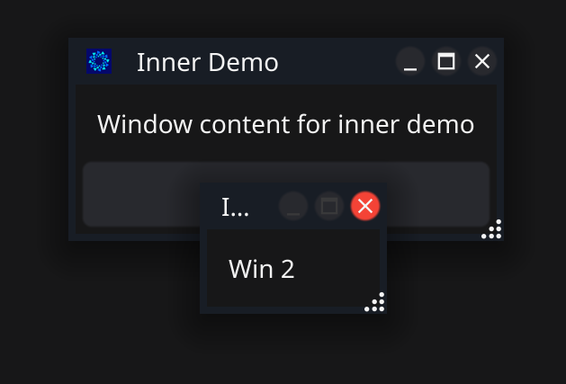

---

# Window Manager (x11)

* Event handling
* Translate state to x11 API
* System integration

  * property handling
  * device info 

* Optimisations (important!)


---

# Compositor

---

# Compositor: capture

*
* Capture visible windows
* Event routing (panels etc)
* Handling buffers
* Manage effects


---

# Compositor: draw

* Background
* Underlays (files, widgets)
* Windows
* Panels & overlays
* Animations


---

# Virtual Desktops

---

# What is a Virtual Desktop?

*
* Just a big virtual space
* More windows, more pixels!
* Move the image, not window
* *And sync actual X11 windows*

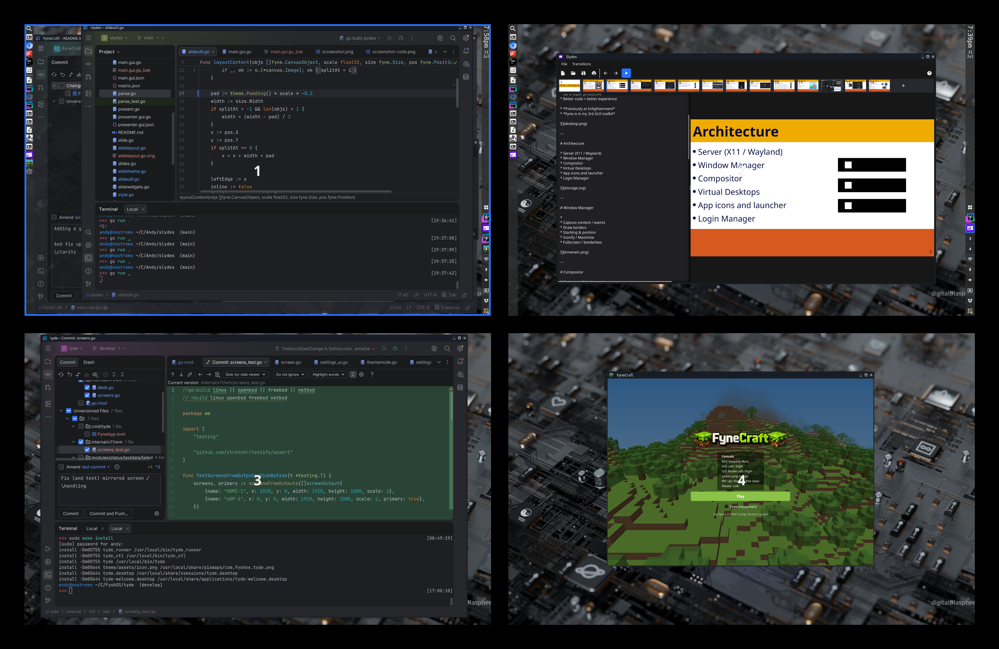

---

# Navigating virtual desktops

*
* Arrange in logical space
* Desktop pager previews
* menu items & keys to move
* Key bind to flip & zoom

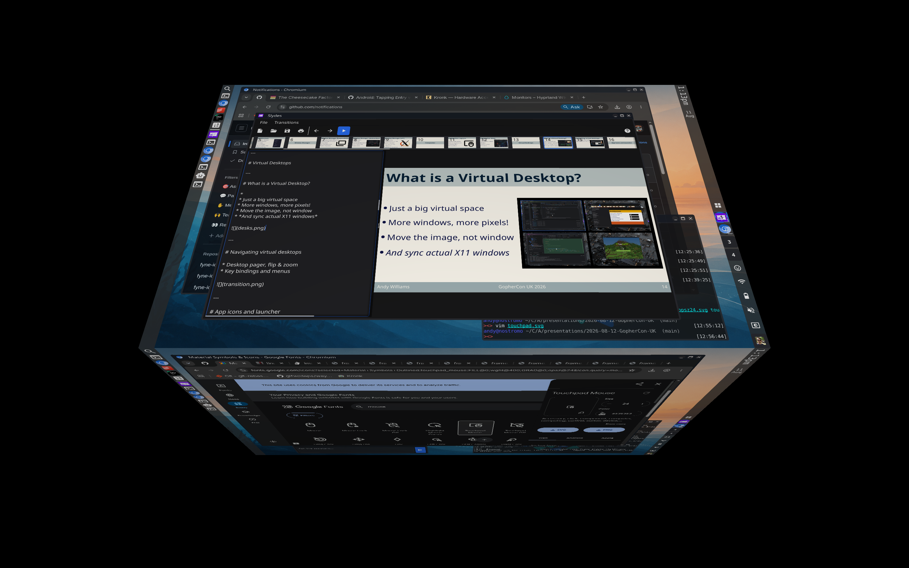

---

# App icons and launcher

---

# Managing Apps

* Find system and user apps
* Load metadata and icons
* Handle launch configurations
* Provide to app bar
* Launcher suggestions


---

# Suggestions in Launcher

* Conversions (size, price etc)
* Calculations
* Launch URLs
* Show QR codes, big text
* Search the web
* AI suggestions/chat

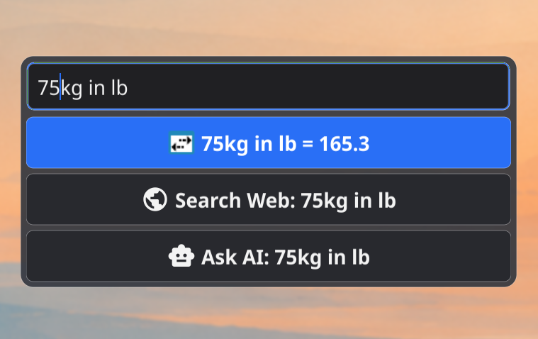
---

# Launcher extension

```go
type LaunchSuggestion interface {
	Icon() fyne.Resource
	Title() string
	Launch()
}

// module info goes here
```

---

# AI Integration

---

# AI Integration - local and frontier

* Local with Kronk or Ollama
* Connect OpenAI or Anthropic
* Fathom: Chat and quick answers
* Choose model and reasoning
* Control the desktop (in progress)

<!-- info streaming directly to a fyne RichText -->
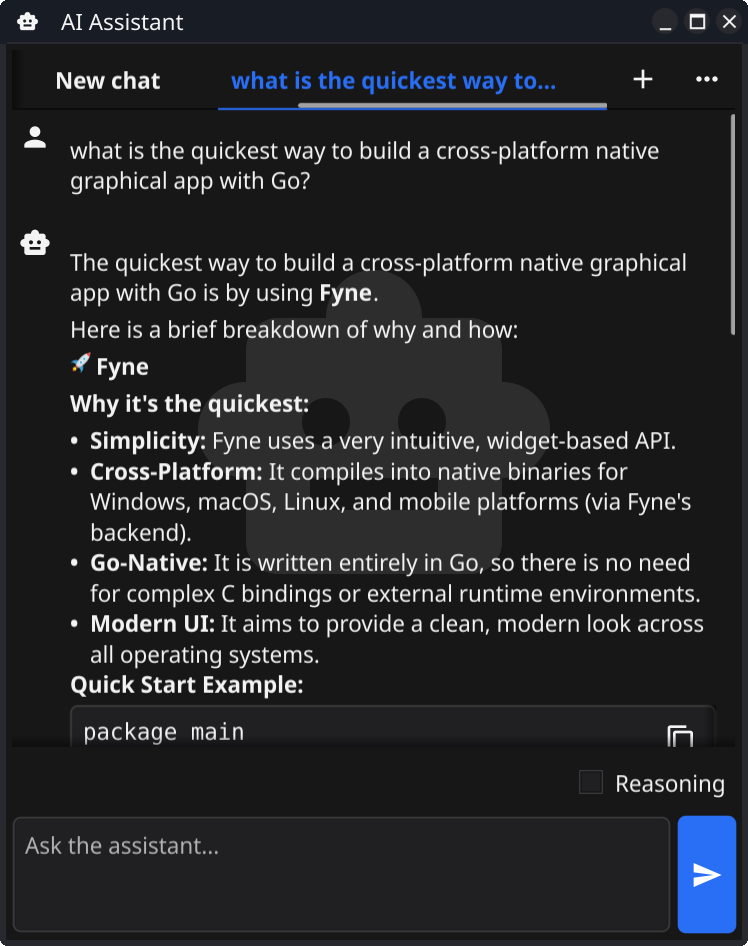

---

# AI Integration - from the start

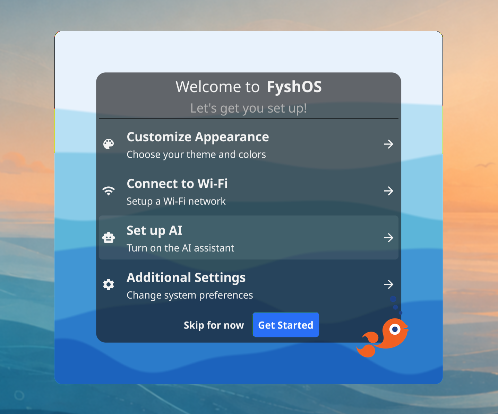

---

# Modules & Overlays

---

# Modules

 Main extensibility points:

  * Status area (system tray, wifi etc)
  * Background / Overlay (fyles, quake term)
  * Launcher (conversion, web search, AI)
  * Keyboard (brightness, volume etc)
  * Accessories (eSheep)

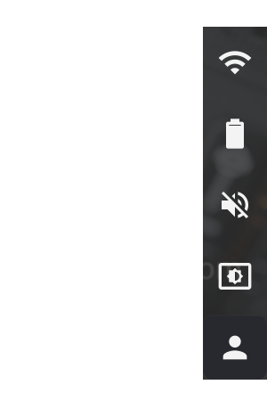

---

# Status area (system tray, wifi)

```go
type StatusAreaModule interface {
	Module
	StatusAreaWidget() fyne.CanvasObject
}
```

---

# Screen area (Background, Fyles)

```go
type ScreenAreaModule interface {
	Module
	ScreenAreaWidget() fyne.CanvasObject
}
```

---

# Overlays (Quake term)

```go
type OverlayAreaModule interface {
	Module
	OverlayAreaWidget() fyne.CanvasObject
}
```

---

# Launcher (conversion, web, AI)

```go
type LaunchSuggestion interface {
	Icon() fyne.Resource
	Title() string
	Launch()
}

type LaunchSuggestionModule interface {
	Module
	LaunchSuggestions(string) []LaunchSuggestion
}
```

---

# Keyboard shortcuts (volume etc)

```go
type KeyBindModule interface {
	Shortcuts() map[*Shortcut]func()
}
```

---

# Window Accessories (eSheep)

```go
type WindowAccessory struct {
	Object fyne.CanvasObject
	Window Window
}

type WindowAccessoryModule interface {
	Module
	WindowAccessories() []WindowAccessory
}
```

---

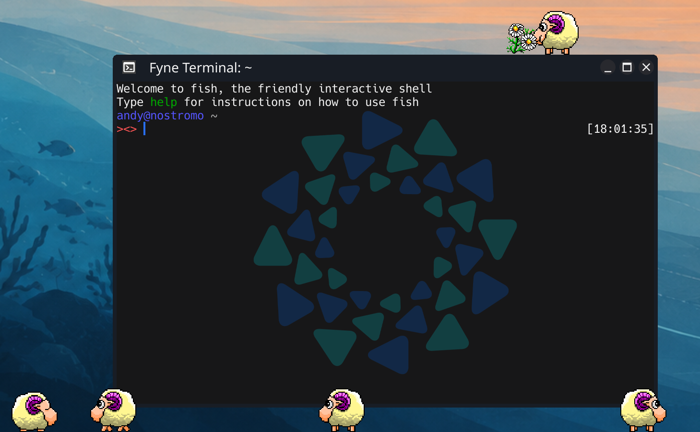

---

# ScreenSaver

---

# ScreenSaver

* Just another Fyne app
* One window per screen
* Fullscreen - swallow all events
* Password and fingerprint support
* Drop-in custom visual

---

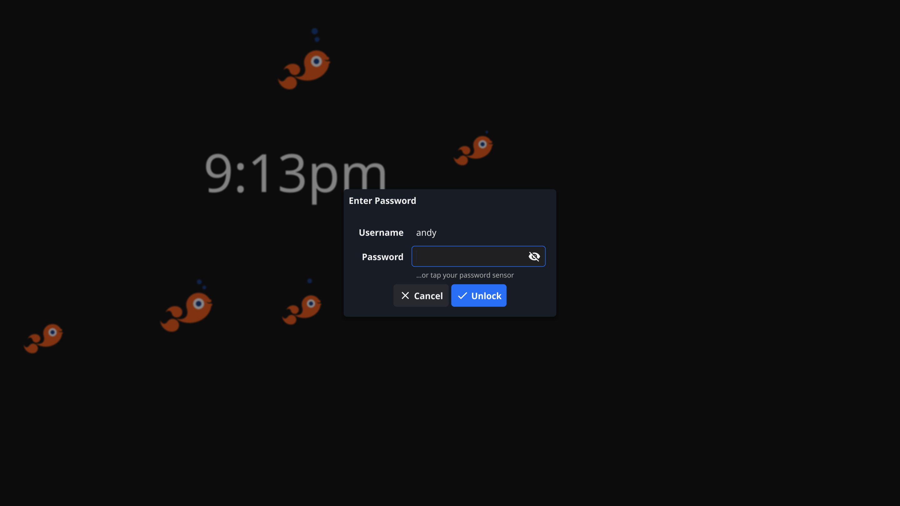

---

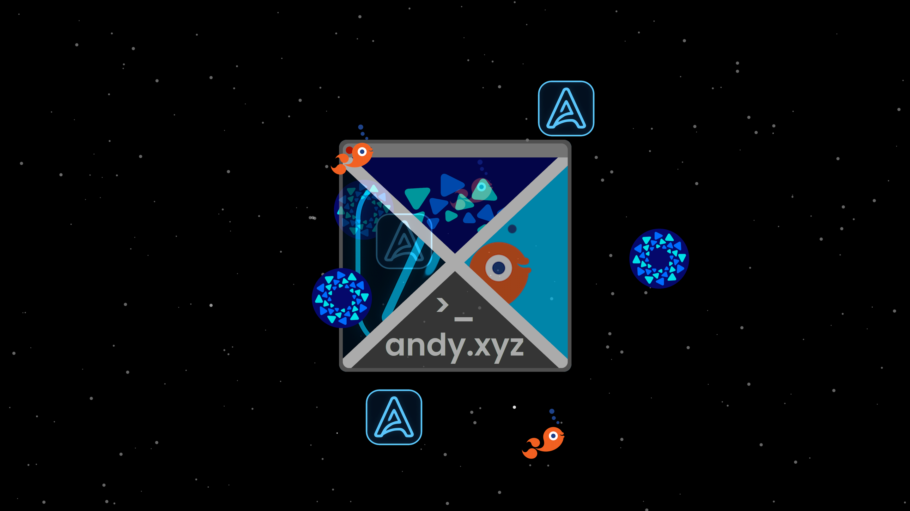

---

# AND System Settings

* Appearance
* Desktop behaviour
* User management
* Hardware management
* System settings

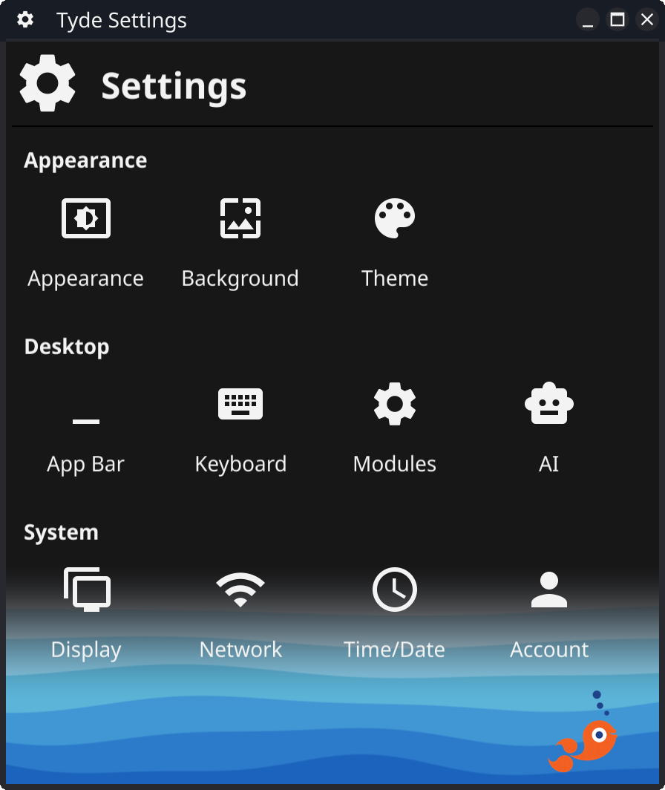

---

# Login Manager

<!-- our first external app -->

---

# Login Manager Responsibilities
<!-- also called display manager -->

* Launch graphical context
* Display users and options
* Handle authentication

--
<!-- line before and after user auth -->

* Initiate user session
* Actually launch desktop


---

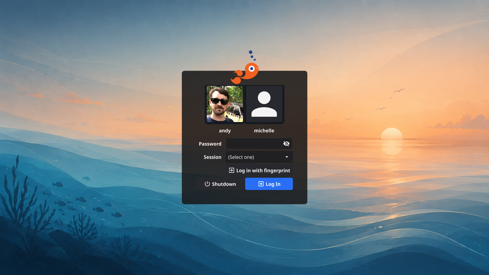

---


# All Together = FyshOS

---

# FyshOS repositories

  * tyde & fin
  * backgrounds, appie
  * dryvers, screens
  * fancyfs, fyles
  * fyshsaver
  * ferry


---

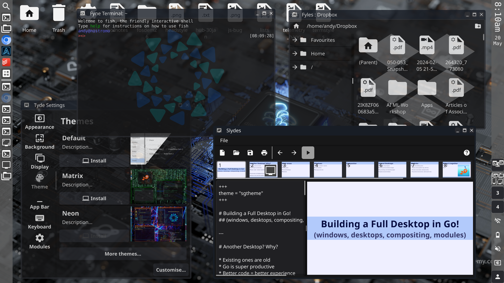

---

# Bonus: WYSIWYG App Editing

---

#  WYSIWYG App Editing

* Visual app editing
* Drag and drop
* Preview for desktop & mobile
* Compile to native apps
* Works from FyshOS source code

<!-- recognise the simplicity of vb6? -->
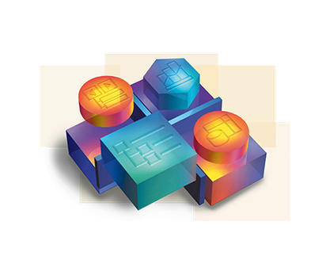

---

# App Editing - Apptrix.org

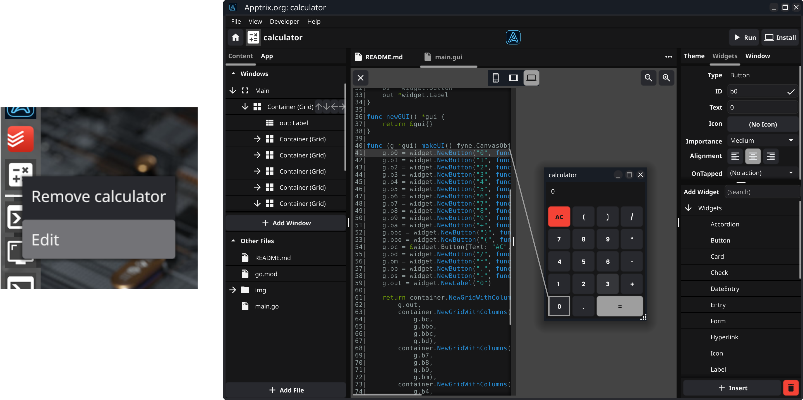

---

# Find out more

* https://fyshos.com
* github.com/FyshOS/tyde
* #fyne
* @andydotxyz
* https://andy.xyz
* https://apptrix.ai


